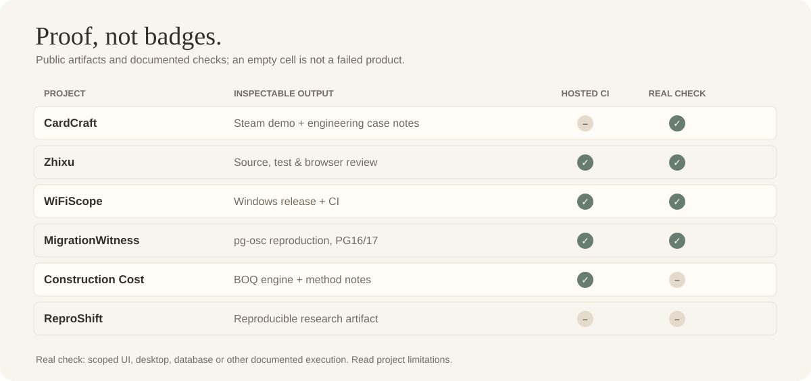

# Yue Yu · 于越

**Engineering Management × Computer Science**  
Northeast Forestry University · 东北林业大学 · Computer Science & Technology minor

I build software for real engineering problems, then test what breaks.  
将真实的工程问题转化为软件，并通过实验验证系统的边界。

[**Explore interactive portfolio ↗**](https://kaiseriiii.github.io/KaiserIIII/) · [Steam demo](https://store.steampowered.com/app/4338300/) · [Personal website](https://kaiseriii.tech/) · [Repositories](https://github.com/KaiserIIII?tab=repositories)

---

### At a glance / 成果速览

| [**153**](https://github.com/KaiserIIII/zhixu/blob/main/docs/verification.md) | [**1,500**](https://github.com/KaiserIIII/construction-cost-analyzer/blob/main/docs/data-sources.md) | [**12**](https://github.com/KaiserIIII/migrationwitness/blob/main/PG_OSC_197_RESULTS.md) | [**Steam ↗**](https://store.steampowered.com/app/4338300/) |
| :--- | :--- | :--- | :--- |
| Zhixu backend + frontend tests 知识库验证 | ONS construction index observations 官方建筑价格指数 | PostgreSQL migration & control runs 迁移与对照实验 | Playable demo 可试玩产品 |

    

Workflow badges report hosted checks, not production readiness. Figures link to their documented scope; index observations are not completed projects.

  

**Explore by interest / 按兴趣探索:** [Built environment](https://kaiseriiii.github.io/KaiserIIII/?case=cost) · [Knowledge systems](https://kaiseriiii.github.io/KaiserIIII/?case=zhixu) · [Network evidence](https://kaiseriiii.github.io/KaiserIIII/?case=wifiscope) · [Reliability lab](https://kaiseriiii.github.io/KaiserIIII/?lab=permission#lab)

### 01 / Selected work · 代表作品

<table>
  <tr>
    <td width="50%" valign="top">
      <b><a href="https://github.com/KaiserIIII/cardcraft-engineering-portfolio">CardCraft Engineering</a></b> 
      Game development · Godot · Steam  
      Steam demo, multiplayer state validation, Workshop integration, save migration and release workflows. 
      卡牌游戏、Steam 联机、创意工坊及发布工程。  
      <a href="https://store.steampowered.com/app/4338300/">Playable Steam demo ↗</a>
    </td>
    <td width="50%" valign="top">
      <b><a href="https://github.com/KaiserIIII/zhixu">Zhixu / 知序</a></b> 
      Backend · FastAPI · RAG  
      Self-hosted knowledge system with tenant isolation, hybrid retrieval, citations and versioned workflows. 120 backend + 33 frontend tests documented. 
      多租户知识系统、检索溯源和可视化流程。  
      <a href="https://github.com/KaiserIIII/zhixu/blob/main/docs/verification.md">Verification notes ↗</a>
    </td>
  </tr>
  <tr>
    <td valign="top">
      <b><a href="https://github.com/KaiserIIII/WiFiScope">WiFiScope</a></b> 
      Network protocols · Python · Desktop  
      Local-first network investigation built around bounded checks, PCAP evidence, and privacy-aware reporting. 
      网络调查、数据取证和本地优先工具设计。  
      <a href="https://github.com/KaiserIIII/WiFiScope/releases/latest">Windows release ↗</a>
    </td>
    <td valign="top">
      <b><a href="https://github.com/KaiserIIII/construction-cost-analyzer">Construction Cost Analyzer</a></b> 
      Built environment · Quantification · Python  
      Auditable quantity takeoff, unit rates, BOQs and appraisal. 1,500 official ONS index observations; bilingual Excel and report exports. 
      从工程计量到组价和开发评价的计算工具。  
      <a href="https://github.com/KaiserIIII/construction-cost-analyzer/blob/main/docs/course-methods.md">Methods & assumptions ↗</a>
    </td>
  </tr>
</table>

Take a closer look / 交互式系统拆解：[CardCraft](https://kaiseriiii.github.io/KaiserIIII/?case=cardcraft) · [Zhixu](https://kaiseriiii.github.io/KaiserIIII/?case=zhixu) · [WiFiScope](https://kaiseriiii.github.io/KaiserIIII/?case=wifiscope) · [Cost Analyzer](https://kaiseriiii.github.io/KaiserIIII/?case=cost)

Want a quick introduction? / 想快速了解我的作品？[Follow a guided story / 双语互动导览 ↗](https://kaiseriiii.github.io/KaiserIIII/?trail=verify&note=1)

Curious how projects connect? / 想知道两个不同领域的项目有什么联系？[Explore a side-by-side comparison ↗](https://kaiseriiii.github.io/KaiserIIII/?compare=zhixu,migrationwitness#compare)

Try a real interaction / 亲手运行两个简化的工程故障实验：[Reliability Lab ↗](https://kaiseriiii.github.io/KaiserIIII/?lab=permission#lab) · [Tenant Boundary ↗](https://kaiseriiii.github.io/KaiserIIII/?lab=retrieval#lab)

<b>Engineering evidence / 工程证据矩阵</b>

### 02 / Research & reproducibility · 实验与研究

I like experiments that reveal *why* something fails or behaves unexpectedly. I try to keep the methods and limitations alongside the code. 我会保留实验方法、真实环境记录和不符合预期的结果，而不是只留下漂亮的结论。

- **[MigrationWitness](https://github.com/KaiserIIII/migrationwitness)** — a real PostgreSQL 16/17 migration-permission regression and independent application-contract checks. / 数据库迁移权限问题的实证复现。
- **[ReproShift](https://github.com/KaiserIIII/reproshift-artifact)** — reproducibility and dependency compatibility across historical Python environments. / 历史依赖环境与可复现性。
- **[Return-to-Source Hysteresis](https://github.com/KaiserIIII/return-to-source-hysteresis)** — test-time adaptation experiments, including negative findings. / 测试时自适应实验。
- **[CS Nature Paper Skill](https://github.com/KaiserIIII/cs-nature-paper-skill)** — research workflows, evidence tracking and experimental review. / 科研流程与证据管理。

### 03 / Explore the system · 交互作品集

  

**Search the work, not a skill score:** press Ctrl/⌘ K in the portfolio and ask about database reliability, published products, or construction computing. The local bilingual retrieval engine links each result to its source and limits.

There's also an [interactive portfolio ↗](https://kaiseriiii.github.io/KaiserIIII/) with original motion graphics, draggable relationships, a searchable archive, **side-by-side project comparisons**, and source-linked system blueprints. [Source ↗](https://github.com/KaiserIIII/KaiserIIII/tree/main/experience)

也可以打开[在线交互作品集 ↗](https://kaiseriiii.github.io/KaiserIIII/)看看动态设计、可比较的项目关系、快捷搜索、中英双语和可以逐步探索的系统剖面；[完整源码](https://github.com/KaiserIIII/KaiserIIII/tree/main/experience)可以直接查看。

<b>More projects / 更多项目</b>

**Software & tools:** [QLDeviceCheck](https://github.com/KaiserIIII/QLDeviceCheck_Generic_WebUI_Linux) · [ImportProof](https://github.com/KaiserIIII/importproof) · [DeskTrace](https://github.com/KaiserIIII/desktrace) · [CancelProof](https://github.com/KaiserIIII/cancelproof) · [LangBot Attachment Pipeline](https://github.com/KaiserIIII/langbot-unified-attachment-pipeline)

**Research & workflows:** [Research Discovery](https://github.com/KaiserIIII/research-discovery) · [Calendar Migration Auditor](https://github.com/KaiserIIII/calendar-migration-auditor) · [RelayDesk](https://github.com/KaiserIIII/relaydesk) · [CourseRelay](https://github.com/KaiserIIII/courserelay)

**Public GitHub metadata:** The following image is generated from public-repository data only, not a score of ability.

Curiosity across disciplines · Build / Test / Learn

