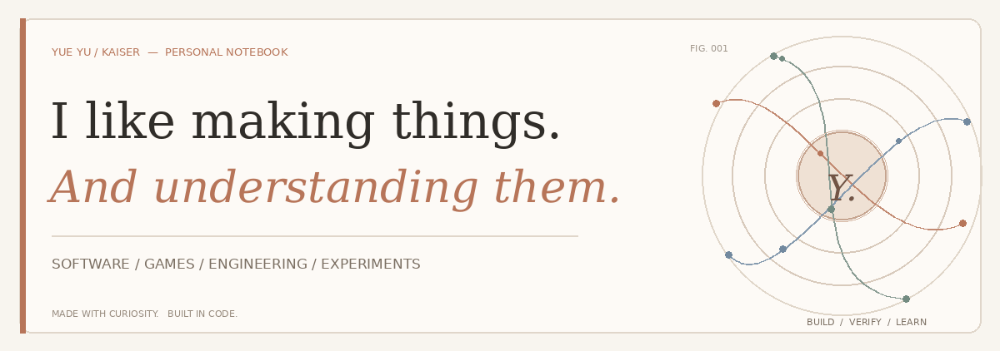

  

<h2 align="center">Yue Yu · 于越</h2>

  <b>Engineering Management undergraduate · Minor in Computer Science &amp; Technology</b> 
  <b>Northeast Forestry University · 东北林业大学</b> 
  软件系统 / Software Systems &nbsp;·&nbsp; 工程计算 / Construction Technology &nbsp;·&nbsp; 可靠性与科研 / Reliability &amp; Research

  <a href="https://kaiseriii.tech/"><b>Portfolio / 个人网站</b></a> &nbsp;·&nbsp;
  <a href="https://github.com/KaiserIIII/KaiserIIII/tree/main/experience"><b>Interactive Explorer / 交互作品源码</b></a> &nbsp;·&nbsp;
  <a href="https://store.steampowered.com/app/4338300/"><b>Steam Demo</b></a> &nbsp;·&nbsp;
  <a href="https://kaiseriii.tech/#contact"><b>Contact / 联系</b></a>

---

I build **usable software systems** and turn engineering questions into **reproducible experiments**. My interests connect backend/data engineering, software reliability, applied AI and the built environment.

我在工程管理与计算机科学的交叉领域实践：不仅做软件，也重视**数据边界、可复现验证、交付成果与实验局限**。下面的每个核心结论都能追溯到公开源码、发布物或验证记录。

### Three proof points / 三条能直接核验的技术证据

| 交付 / Shipping | 系统 / Systems | 验证 / Verification |
|:--|:--|:--|
| **CardCraft · Steam Demo** Godot · Steam P2P · Workshop [Playable demo / 可玩版本 ↗](https://store.steampowered.com/app/4338300/) | **Zhixu · 120 + 33 tests** FastAPI · multi-tenant · RAG [2026-10-08 test record / 测试记录 ↗](https://github.com/KaiserIIII/zhixu/blob/main/docs/verification.md) | **MigrationWitness · PostgreSQL 16/17** SQL contracts · migration regression [Reproduction / 实验复现 ↗](https://github.com/KaiserIIII/migrationwitness/blob/main/CROSS_VERSION_RESULTS.md) |

Zhixu's 120 backend and 33 frontend tests are from a dated verification run, not a coverage metric. Tests and experimental reproductions are scoped evidence, not universal production guarantees. / 测试项数来自特定日期的验证记录，不代表覆盖率或生产环境认证。

### Industry / HR · 面向招聘方

**Systems, APIs & delivery / 系统开发与交付。** I have worked on user-facing software, data workflows, test automation, and release artifacts, across Godot, Python/FastAPI, SQL systems and developer tools. 重点查看：

- **[Zhixu / 知序](https://github.com/KaiserIIII/zhixu)** — tenant-scoped knowledge infrastructure, hybrid retrieval, workflow versioning and test-backed boundary decisions / 多租户知识系统、混合检索、版本化工作流。
- **[WiFiScope](https://github.com/KaiserIIII/WiFiScope)** — bounded TCP/TLS inspection, PCAP evidence, local SQLite records and a [Windows release](https://github.com/KaiserIIII/WiFiScope/releases/latest) / 网络协议与桌面软件交付。
- **[CardCraft Engineering](https://github.com/KaiserIIII/cardcraft-engineering-portfolio)** — Steam multiplayer lifecycle, save migration, Workshop integration and a playable demo / 游戏系统工程，公开工程案例；商业游戏源码保持私有。

### Graduate admissions · 面向研究生招生官

**Engineering × Computing / 工程与计算交叉。** My undergraduate background in Engineering Management and minor in Computer Science and Technology shape my interest in rigorous experimentation, software systems and computational approaches to engineering problems. 重点查看：

- **[MigrationWitness](https://github.com/KaiserIIII/migrationwitness)** — reproduces an actual PostgreSQL migration privilege-regression and checks application contracts independently / 数据库迁移实验与独立验证。
- **[ReproShift](https://github.com/KaiserIIII/reproshift-artifact)** — reproducible historical Python dependency-compatibility experiments / 可复现的依赖兼容性研究工件。
- **[Construction Cost Analyzer](https://github.com/KaiserIIII/construction-cost-analyzer)** — quantity takeoff, BOQ calculations, unit-rate models and appraisal with explicit [methods](https://github.com/KaiserIIII/construction-cost-analyzer/blob/main/docs/course-methods.md) / 工程计量、造价与计算机系统交叉实践。
- **[Return-to-Source Hysteresis](https://github.com/KaiserIIII/return-to-source-hysteresis)** — experimental test-time adaptation artifact, including negative or conditional findings / 保留负面结果与研究局限的实验工件。

### Explore the connections / 探索技术能力图谱

  

The [interactive version](https://github.com/KaiserIIII/KaiserIIII/tree/main/experience) includes an animated SVG graph, draggable nodes, bilingual content and **industry / graduate admissions** reading modes. It is versioned with tests and can run as a standalone HTML page. / 交互版支持节点拖拽、中英切换，以及招聘与申请两种阅读视角。正式在线交互地址需完成独立网页部署。

<b>More repositories & evidence / 更多项目及验证材料</b>

**Engineering and industrial tools / 工程与工业**  
[QLDeviceCheck](https://github.com/KaiserIIII/QLDeviceCheck_Generic_WebUI_Linux) · [Construction Cost Analyzer](https://github.com/KaiserIIII/construction-cost-analyzer) · [Campus UAV Inspection Manager](https://github.com/KaiserIIII/-UAV-inspection-task-management-system-in-college-parks)

**Data quality and reliability / 数据质量与可靠性**  
[ImportProof](https://github.com/KaiserIIII/importproof) · [CancelProof](https://github.com/KaiserIIII/cancelproof) · [DeskTrace](https://github.com/KaiserIIII/desktrace) · [Calendar Migration Auditor](https://github.com/KaiserIIII/calendar-migration-auditor)

**Research and AI tools / AI 与科研**  
[CS Nature Paper Skill](https://github.com/KaiserIIII/cs-nature-paper-skill) · [Research Discovery](https://github.com/KaiserIIII/research-discovery) · [LangBot Attachment Pipeline](https://github.com/KaiserIIII/langbot-unified-attachment-pipeline)

**Developer infrastructure / 开发工具**  
[Claude ↔ Codex Bridge](https://github.com/KaiserIIII/claude-codex-bridge) · [RelayDesk](https://github.com/KaiserIIII/relaydesk) · [CourseRelay](https://github.com/KaiserIIII/courserelay) · [KAISER website source](https://github.com/KaiserIIII/kaiser-site)

GitHub telemetry uses public repositories only; it does not measure programming ability, contributions or private work.

---

<i>Build working systems. Verify claims. Explain decisions.</i> <a href="https://kaiseriii.tech/">kaiseriii.tech</a> · <a href="https://github.com/KaiserIIII?tab=repositories">Public repositories</a>

