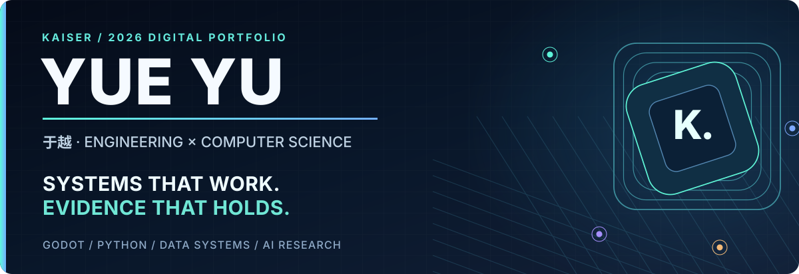

  <a href="https://kaiseriii.tech"><b>Website</b></a> &nbsp;·&nbsp;
  <a href="https://kaiseriii.tech/projects/"><b>Case studies</b></a> &nbsp;·&nbsp;
  <a href="https://store.steampowered.com/app/4338300/"><b>Steam demo</b></a> &nbsp;·&nbsp;
  <a href="https://kaiseriii.tech/#contact"><b>Contact</b></a>

## Hello, I'm Yue Yu / 于越

**Engineering Management × Computer Science** · Northeast Forestry University

I build software that turns domain complexity into **usable products, inspectable experiments, and testable systems**. 我关注的不只是实现功能，更是系统边界、失败处理、复现证据与交付质量。

This GitHub profile is itself a small, **code-generated information design system**: original vector diagrams, public-data analysis, deterministic rendering, validation tests, and a CI publishing pipeline. No remote image badges, screenshot walls, fabricated proficiency percentages, or private-repository statistics.

### 01 — What I can engineer

Rather than claiming “I know everything”, these are concrete trails from a **technical capability** to a **source repository you can inspect**.

| Engineering strength | A concrete proof point |
|:--|:--|
| **System architecture & state** | [CardCraft engineering](https://github.com/KaiserIIII/cardcraft-engineering-portfolio) — Godot, Steam P2P, save boundaries; [Zhixu](https://github.com/KaiserIIII/zhixu) — FastAPI, tenant-scoped knowledge and visual workflows |
| **Data, protocols & numerical correctness** | [WiFiScope](https://github.com/KaiserIIII/WiFiScope) — bounded TCP/TLS/PCAP analysis; [Construction Cost Analyzer](https://github.com/KaiserIIII/construction-cost-analyzer) — Decimal-based cost and appraisal calculations |
| **Reproducible testing & failure analysis** | [MigrationWitness](https://github.com/KaiserIIII/migrationwitness) — PostgreSQL 16/17 migration reproduction; [ImportProof](https://github.com/KaiserIIII/importproof) — real LibreOffice import/export acceptance |
| **Research workflow engineering** | [ReproShift](https://github.com/KaiserIIII/reproshift-artifact) — dependency-compatibility artifact; [CS Nature Paper Skill](https://github.com/KaiserIIII/cs-nature-paper-skill) — evidence and protocol orchestration |

### 02 — Live engineering telemetry

Source: public GitHub REST repository metadata, filtered to this account. The figure reports <b>repositories</b>, not commits or amount of code. Its timestamp is printed in the diagram. [Renderer source](tools/render_live_metrics.py) · [Tests](tests/test_profile_renderer.py) · [Scheduled workflow](.github/workflows/profile-telemetry.yml).

### 03 — The work, not the badges

| Selected work | Engineering decisions worth inspecting | Evidence |
|:--|:--|:--|
| **[CardCraft](https://github.com/KaiserIIII/cardcraft-engineering-portfolio)** | Online/offline battle paths, P2P message validation, Workshop packages and save migration | [Steam playable demo](https://store.steampowered.com/app/4338300/) · [Public technical cases](https://github.com/KaiserIIII/cardcraft-engineering-portfolio) |
| **[Zhixu](https://github.com/KaiserIIII/zhixu)** | Multi-tenant isolation, retrieval provenance, versioned workflows, async service lifecycle | [Verification & limits](https://github.com/KaiserIIII/zhixu/blob/main/docs/verification.md) |
| **[WiFiScope](https://github.com/KaiserIIII/WiFiScope)** | Target-scope validation, bounded network operations, privacy-preserving evidence | [Portable release](https://github.com/KaiserIIII/WiFiScope/releases/latest) · [Validation](https://github.com/KaiserIIII/WiFiScope/blob/main/docs/validation.md) |
| **[MigrationWitness](https://github.com/KaiserIIII/migrationwitness)** | A migration can exit successfully and still violate the application contract | [Reproduced pg-osc case](https://github.com/KaiserIIII/migrationwitness/blob/main/PG_OSC_197_RESULTS.md) · [Cross-version runs](https://github.com/KaiserIIII/migrationwitness/blob/main/CROSS_VERSION_RESULTS.md) |
| **[Construction Cost Analyzer](https://github.com/KaiserIIII/construction-cost-analyzer)** | Auditable unit rates, BOQs, monthly cash flows and rounding conventions | [Methods and assumptions](https://github.com/KaiserIIII/construction-cost-analyzer/blob/main/docs/course-methods.md) · [Interactive lab](https://kaiseriii.tech/projects/construction-cost-analyzer/lab/) |
| **[QLDeviceCheck](https://github.com/KaiserIIII/QLDeviceCheck_Generic_WebUI_Linux)** | Config snapshots, Modbus inspection, immutable results and failed-only retests | [Demo](https://github.com/KaiserIIII/QLDeviceCheck_Generic_WebUI_Linux/blob/main/docs/DEMO.md) · [Validation](https://github.com/KaiserIIII/QLDeviceCheck_Generic_WebUI_Linux/blob/main/docs/VALIDATION.md) |

### 04 — The technology behind this README

**This is an engineered page, not a pre-made profile template.** Every visual is generated by the same [Python standard-library SVG renderer](tools/render_live_metrics.py) and versioned in this repository. The diagram layout is mathematical (Bezier connections, parameterized spacing, mapped evidence edges). It ships without JavaScript, trackers, external fonts, CDN cards, or any special browser permissions.

The [automated workflow](.github/workflows/profile-telemetry.yml) executes [deterministic unit tests](tests/test_profile_renderer.py) and [visual-system checks](tests/test_visual_system.py), collects **public-only metadata**, regenerates the diagrams, and commits changed artifacts. Untrusted labels are XML-escaped; SVG output is parsed before publication. See the [implementation notes](docs/PROFILE_ENGINEERING.md) for the design, data contract and limitations.

<b>Inspect the technical proof matrix / 展开验证矩阵</b>

A mark means the repository documents **a type of evidence**, not production readiness or general correctness. For example: [Zhixu verification](https://github.com/KaiserIIII/zhixu/blob/main/docs/verification.md), [MigrationWitness cross-version tests](https://github.com/KaiserIIII/migrationwitness/blob/main/CROSS_VERSION_RESULTS.md), [WiFiScope validation](https://github.com/KaiserIIII/WiFiScope/blob/main/docs/validation.md).

### 05 — More research & tools

**Research:** [Return-to-Source Hysteresis](https://github.com/KaiserIIII/return-to-source-hysteresis) · [Research Discovery](https://github.com/KaiserIIII/research-discovery) · [ReproShift](https://github.com/KaiserIIII/reproshift-artifact) · [CS Nature Paper Skill](https://github.com/KaiserIIII/cs-nature-paper-skill).

**Tools and integrations:** [DeskTrace](https://github.com/KaiserIIII/desktrace) · [CancelProof](https://github.com/KaiserIIII/cancelproof) · [Calendar Migration Auditor](https://github.com/KaiserIIII/calendar-migration-auditor) · [LangBot Attachment Pipeline](https://github.com/KaiserIIII/langbot-unified-attachment-pipeline) · [RelayDesk](https://github.com/KaiserIIII/relaydesk) · [CourseRelay](https://github.com/KaiserIIII/courserelay) · [KAISER website](https://github.com/KaiserIIII/kaiser-site).

---

<i>Build systems. Verify claims. Explain decisions.</i> <a href="https://kaiseriii.tech">kaiseriii.tech</a> · <a href="https://github.com/KaiserIIII?tab=repositories">All public repositories</a>

