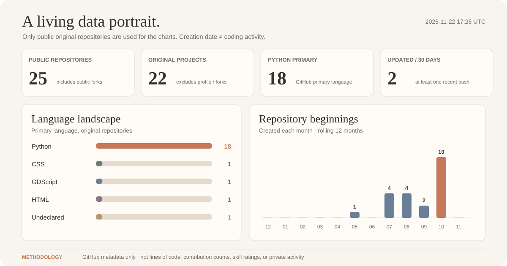
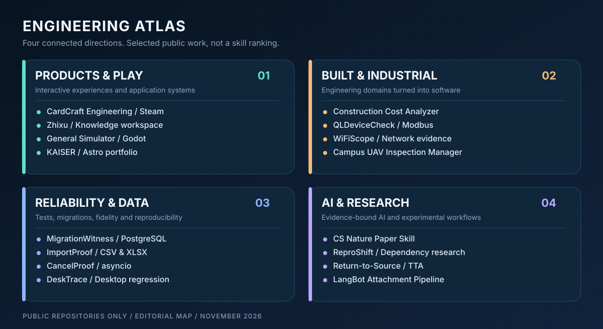
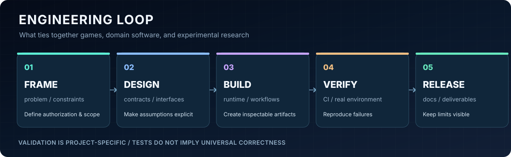

  

  <a href="https://kaiseriii.tech/"><b>PORTFOLIO</b></a> &nbsp;·&nbsp;
  <a href="https://kaiseriii.tech/projects/"><b>PROJECT INDEX</b></a> &nbsp;·&nbsp;
  <a href="https://store.steampowered.com/app/4338300/"><b>STEAM GAME</b></a> &nbsp;·&nbsp;
  <a href="https://kaiseriii.tech/#contact"><b>CONTACT</b></a>

### Hello, I'm Yue Yu / 你好，我是于越

**Engineering Management × Computer Science** · Undergraduate, Northeast Forestry University · 中国 · 东北林业大学

I work across **software products, engineering systems, data reliability, and applied AI research**. My focus is the whole engineering loop: an explicit problem, a working implementation, reproducible checks, and a useful artifact others can inspect.

从工程管理和计算机科学的交叉视角出发，把真实问题做成能运行、能验证、可交付的软件。这里展示的是**代码、证据和局限**，而不只是功能介绍。

---

### 01 / Live portfolio telemetry · 公开仓库实时画像

  

Public GitHub repository metadata only. This self-hosted SVG is regenerated by [a repository workflow](.github/workflows/profile-telemetry.yml) approximately twice weekly; its timestamp is shown in the image. Repository creation is **not** commit activity. Forks, profile README and private code are separated; no subjective skill percentages. / 仅统计公开仓库元数据，自动刷新；不把仓库创建数冒充代码提交量。

### 02 / The systems map · 我的技术领域

  

Editorial map of **representative public work**, not a repository count or skill rating. / 代表性公开项目地图，非能力评分。

### 03 / Selected builds · 代表项目

| Project | Engineering focus | Inspectable result |
|:--|:--|:--|
| **[CardCraft Engineering / 卡制工程](https://github.com/KaiserIIII/cardcraft-engineering-portfolio)** | Godot · GDScript · Steam networking · Workshop content · persistence | **[Steam demo](https://store.steampowered.com/app/4338300/)** · [Public engineering case studies](https://github.com/KaiserIIII/cardcraft-engineering-portfolio) |
| **[Zhixu / 知序](https://github.com/KaiserIIII/zhixu)** | FastAPI · tenant isolation · hybrid retrieval · workflow versions | [Source](https://github.com/KaiserIIII/zhixu) · [Verification scope](https://github.com/KaiserIIII/zhixu/blob/main/docs/verification.md) |
| **[WiFiScope](https://github.com/KaiserIIII/WiFiScope)** | Bounded TCP/TLS checks · network evidence · private reports | [Windows release](https://github.com/KaiserIIII/WiFiScope/releases/latest) · [CI](https://github.com/KaiserIIII/WiFiScope/actions) |
| **[MigrationWitness](https://github.com/KaiserIIII/migrationwitness)** | PostgreSQL migration correctness · contract / privilege checks | [Real pg-osc reproduction](https://github.com/KaiserIIII/migrationwitness/blob/main/PG_OSC_197_RESULTS.md) · [Cross-version tests](https://github.com/KaiserIIII/migrationwitness/blob/main/CROSS_VERSION_RESULTS.md) |
| **[Construction Cost Analyzer](https://github.com/KaiserIIII/construction-cost-analyzer)** | Quantity takeoff · BOQ · unit rates · development appraisal | [Methods & boundaries](https://github.com/KaiserIIII/construction-cost-analyzer/blob/main/docs/course-methods.md) · [Interactive lab](https://kaiseriii.tech/projects/construction-cost-analyzer/lab/) |
| **[QLDeviceCheck](https://github.com/KaiserIIII/QLDeviceCheck_Generic_WebUI_Linux)** | Modbus · device inspection · configuration snapshots · failed-only retests | [Demo guide](https://github.com/KaiserIIII/QLDeviceCheck_Generic_WebUI_Linux/blob/main/docs/DEMO.md) · [Validation](https://github.com/KaiserIIII/QLDeviceCheck_Generic_WebUI_Linux/blob/main/docs/VALIDATION.md) |

> **A deliberately mixed portfolio:** shipped game engineering, a local network workstation, data and database verification, and software for the built environment. Each project solves a different problem; the same research or product maturity is **not** claimed for all of them.

### 04 / How I engineer · 工程方法

  

<b>Show the project evidence matrix / 展开项目验证矩阵</b>

  

A check indicates **documented evidence of that kind**, not full production qualification, security certification, or a measured skill level. Tests and real-machine checks have different scope. / 勾选仅表示存在相应类型的验证材料，并非商用认证。

### 05 / Research artifacts · 科研与可复现性

| Track | Open project & scope |
|:--|:--|
| **Research automation** | [CS Nature Paper Skill](https://github.com/KaiserIIII/cs-nature-paper-skill) — research graphs, protocol gates and artifact provenance; [Research Discovery](https://github.com/KaiserIIII/research-discovery) — evidence-bound question discovery |
| **Empirical ML** | [Return-to-Source Hysteresis](https://github.com/KaiserIIII/return-to-source-hysteresis) — TTA experiments and negative results; [ReproShift](https://github.com/KaiserIIII/reproshift-artifact) — historical Python dependency repair |
| **Data fidelity** | [ImportProof](https://github.com/KaiserIIII/importproof) — CSV/XLSX comparison with real LibreOffice limitations; [Calendar Migration Auditor](https://github.com/KaiserIIII/calendar-migration-auditor) — occurrence-level ICS review |
| **Runtime robustness** | [CancelProof](https://github.com/KaiserIIII/cancelproof) — targeted `asyncio` cancellation; [DeskTrace](https://github.com/KaiserIIII/desktrace) — Windows desktop regression |
| **Agent / developer tools** | [LangBot Attachment Pipeline](https://github.com/KaiserIIII/langbot-unified-attachment-pipeline) · [Claude ↔ Codex Bridge](https://github.com/KaiserIIII/claude-codex-bridge) |

<b>More software / 更多项目</b>

- [RelayDesk](https://github.com/KaiserIIII/relaydesk) — task, conversation and deliverable continuity
- [CourseRelay](https://github.com/KaiserIIII/courserelay) — course-material provenance and revision mappings
- [PatchVerdict Lab](https://github.com/KaiserIIII/patchverdict-lab) — offline grading-evidence diagnostics
- [General Simulator / 将军模拟器](https://github.com/KaiserIIII/jiangjun) — event-driven Godot strategy prototype
- [Campus UAV Inspection Manager](https://github.com/KaiserIIII/-UAV-inspection-task-management-system-in-college-parks) — Flask / GaussDB scheduling prototype
- [KAISER website source](https://github.com/KaiserIIII/kaiser-site) — Astro / TypeScript
- [Browse every public repository](https://github.com/KaiserIIII?tab=repositories)

---

  <b>BUILD SYSTEMS · VERIFY CLAIMS · SHIP USEFUL WORK</b> 
  Engineering Management × Computer Science / 工程管理 × 计算机科学 
  <a href="https://kaiseriii.tech/">kaiseriii.tech</a> · <a href="https://kaiseriii.tech/projects/">Case studies & project notes</a>

